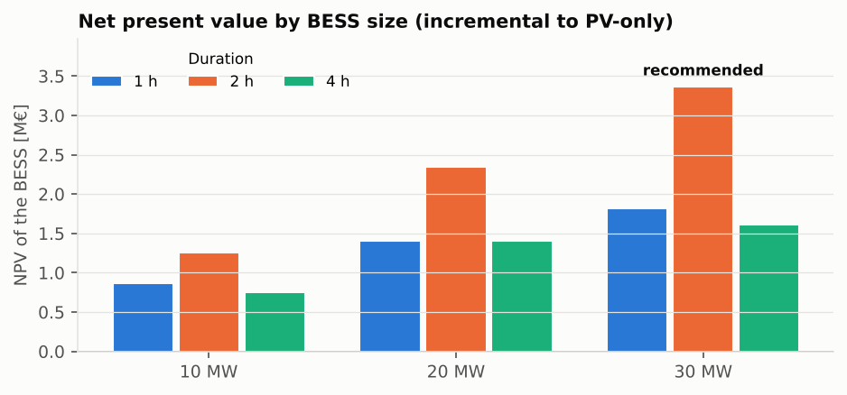
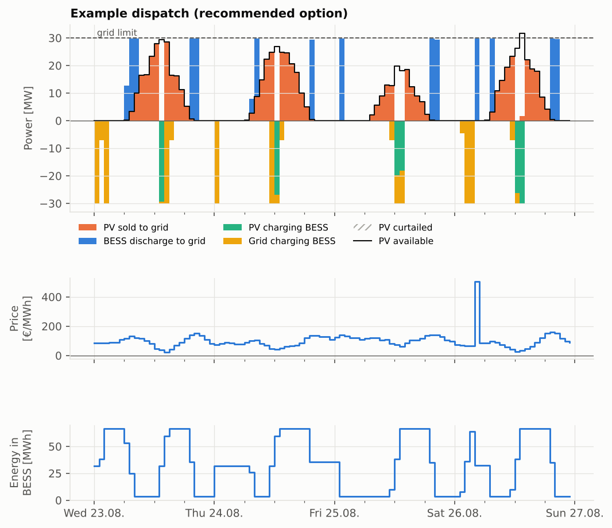
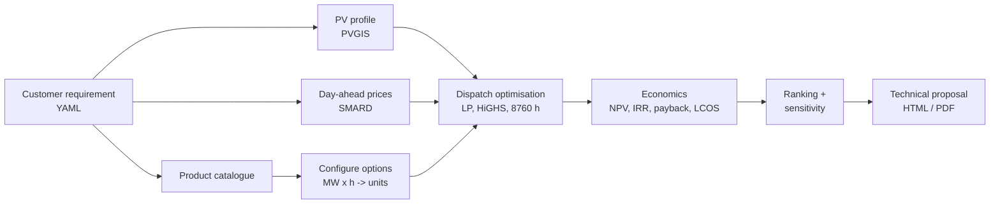
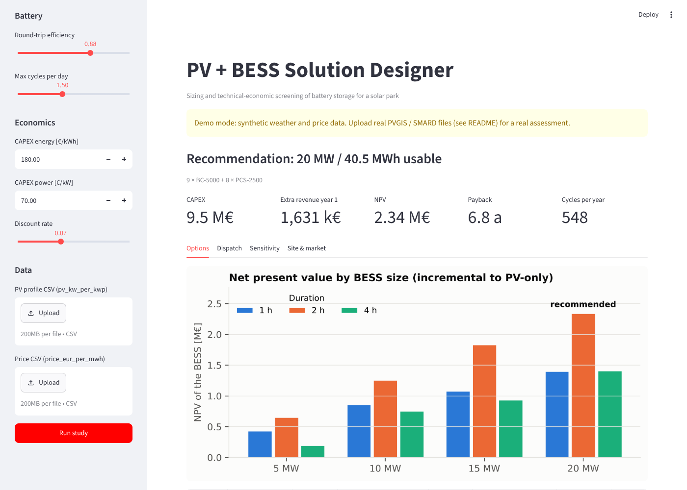

# PV-BESS Solution Designer


Sizing and technical-economic screening of **battery energy storage (BESS) for utility-scale solar parks**.
You describe a customer's site in one YAML file. The tool optimises the hourly operation of PV plant and
battery for a full year and compares battery sizes. It then recommends a configuration from a product
catalogue and writes a customer-ready **technical proposal** (HTML/PDF).

> **Note on the example numbers:** the repository ships with *synthetic* demo data so it runs offline.
> The figures below show what the tool produces. They are not a real site assessment. Run `bess-designer fetch-data`
> to work with real PVGIS weather and SMARD market data (see [Real data](#use-real-data)).

---

## The customer question

> *"Our 50 MWp solar park in Brandenburg sits behind a 30 MW grid connection. At midday we lose energy to the
> grid limit, and in negative-price hours we have to switch off. Which battery should we add, and does it pay off?"*

This situation is common in Germany. PV plants are often built larger than their grid connection. There are more
and more hours with negative day-ahead prices, and new plants get no feed-in payment in those hours. A PV plant also
sells most of its energy when every other PV plant is producing, so its **capture price** is well below the average
market price.

## The answer the tool gives

| | |
|---|---|
| **Recommended system** | 30 MW / 63 MWh usable (14 × 5 MWh containers, 12 × 2.5 MW PCS), AC-coupled |
| **Investment** | 14.7 M€ |
| **Extra revenue, year 1** | 2.49 M€ |
| **NPV (15 a, 7 %)** | 3.4 M€ · IRR 10.7 % · payback 6.9 years |
| **Why this size** | 2 h gives the most value per euro invested. Value still grows with power up to the 30 MW grid connection, which the BESS shares with the PV plant. |
| **Biggest risk** | If grid charging is not allowed (EEG rules for mixed storage), NPV falls below zero → clarify with the customer first |

*(demo data)*




Full example report: [`examples/output/technical_proposal.pdf`](examples/output/technical_proposal.pdf)

## What the tool does



1. **Requirements in, proposal out.** One YAML file holds the site data, the grid connection, the options to compare
   and the economic assumptions. It can be versioned and reviewed like any other document.
2. **Site and market analysis.** PV yield, PV capture price compared to the average price, negative-price hours, and
   how much energy is curtailed today (grid limit compared to negative prices).
3. **Configuration from a product catalogue.** Every target such as "20 MW / 2 h" becomes a buildable configuration
   (number of battery containers and PCS units) from a vendor-neutral catalogue. Swap in real datasheet values to
   configure a specific product family.
4. **Optimal operation.** For each option, a linear program optimises the hourly dispatch for a full year. It
   respects the PV energy balance, battery losses, the state-of-charge window, the PCS rating, the shared grid
   connection and a daily cycle limit.
5. **Economics.** All values are incremental to the same PV plant without storage. The tool calculates CAPEX,
   year-1 margin, capacity fade, NPV, IRR, payback and LCOS, and ranks the options by NPV, IRR or payback.
6. **Sensitivity.** The recommended option is re-run with CAPEX ±20 %, no grid charging, 1 cycle per day and lower
   efficiency, so the customer can see which assumptions drive the result.
7. **Interactive app.** A Streamlit front end to change requirements live in a customer meeting.



## Quick start

```bash
git clone https://github.com/nivedjpnambiar/pv-bess-solution-designer.git
cd pv-bess-solution-designer
pip install -e ".[app,dev]"

# run the example study and write the proposal to examples/output/
bess-designer design examples/brandenburg_50mwp.yaml --out examples/output

# interactive app
streamlit run app/streamlit_app.py

# tests
pytest
```

For a PDF next to the HTML report: `pip install playwright && playwright install chromium`, then add `--pdf`.
Or open the HTML file in a browser and print it to PDF.

## Use real data

```bash
bess-designer fetch-data examples/brandenburg_50mwp.yaml
```

This downloads, for the location and year in the requirement file:

* **PV profile** from [PVGIS](https://joint-research-centre.ec.europa.eu/photovoltaic-geographical-information-system-pvgis_en)
  (EU Joint Research Centre), hourly output per kWp for the given tilt, azimuth and system losses, via `pvlib`.
* **Day-ahead prices DE-LU** from [SMARD](https://www.smard.de) (Bundesnetzagentur).

The command prints the new `data:` block for the YAML file. Use the same year for both files so that sunny hours
and low prices line up as they did in reality.

## Requirement file

```yaml
site:
  pv_dc_mwp: 50.0
  pv_ac_mw: 42.0
  grid_export_limit_mw: 30.0
  grid_import_limit_mw: 30.0
  allow_grid_charging: true
options:
  power_mw: [10, 20, 30]
  duration_h: [1, 2, 4]          # usable energy / power
  rank_by: npv                   # npv | irr | payback
battery:
  roundtrip_efficiency: 0.88
  soc_min: 0.05
  soc_max: 0.95
  max_cycles_per_day: 1.5
economics:
  capex_energy_eur_per_kwh: 180
  capex_power_eur_per_kw: 70
  discount_rate: 0.07
```

See [`examples/brandenburg_50mwp.yaml`](examples/brandenburg_50mwp.yaml) for all fields.

## Method

Per hour *t*, with PV availability $P^{PV}_t$, price $\lambda_t$, time step $\Delta t$ and $\eta = \sqrt{\eta_{RT}}$:

$$\max \sum_t \lambda_t \Delta t \left(p^{pv,grid}_t + p^{dis}_t - p^{grid,ch}_t\right) - c^{wear}\Delta t\, p^{dis}_t$$

subject to

| | |
|---|---|
| PV balance | $p^{pv,grid}_t + p^{pv,ch}_t + p^{curt}_t = P^{PV}_t$ |
| Battery energy | $E_t = E_{t-1} + \eta\,\Delta t\,(p^{pv,ch}_t + p^{grid,ch}_t) - \Delta t\,p^{dis}_t/\eta$ |
| Grid connection | $p^{pv,grid}_t + p^{dis}_t \le P^{grid}_{max}$ |
| PCS rating | $p^{pv,ch}_t + p^{grid,ch}_t + p^{dis}_t \le P^{BESS}$ |
| SoC window | $E_{min} \le E_t \le E_{max}$, $E_T \ge E_0$ |
| Cycle limit | $\sum_t p^{dis}_t \Delta t \le n_{cyc} \cdot E_{usable} \cdot \text{days}$ |

8760 hours × 6 variables, solved with HiGHS (`scipy.optimize.linprog`) in under a second per option. The
reference case is the same PV plant without storage, curtailed in negative-price hours.

## Assumptions and limits

* Perfect foresight of one historical year of day-ahead prices, so the result is an upper bound for the day-ahead market.
* Price taker: the battery does not move the market price.
* Only day-ahead arbitrage and PV shifting are valued. No FCR/aFRR, intraday or capacity revenues.
* AC-coupled: energy lost by DC/AC inverter clipping cannot be recovered.
* Linear capacity fade, no augmentation, no taxes or financing.
* The product catalogue is generic and illustrative.

## Roadmap

- [ ] Revenue stacking with FCR / aFRR capacity markets
- [ ] DC-coupled topology (recover inverter clipping)
- [ ] Rolling-horizon dispatch with price forecasts instead of perfect foresight
- [ ] Cycle-based degradation model and augmentation planning
- [ ] Grid code checks for the connection point (reactive power, grid-forming requirements)

## Project structure

```
src/bess_designer/
  config.py      requirement file (YAML) -> dataclasses + validation
  data.py        PV / price CSV handling, PVGIS and SMARD fetchers
  catalogue.py   MW x h target -> containers and PCS units
  dispatch.py    yearly dispatch LP (HiGHS)
  economics.py   cash flows, NPV, IRR, payback, LCOS
  sizing.py      option sweep, ranking, sensitivity
  charts.py      report charts
  report.py      HTML/PDF technical proposal
  synthetic.py   offline demo data (not real data)
app/             Streamlit front end
examples/        requirement files and generated reports
tests/           pytest suite (constraints, energy balance, economics, data parsing)
```

## Data sources and licences

* PVGIS © European Union, 2001-2026.
* SMARD: Bundesnetzagentur | SMARD.de, licence CC BY 4.0.

## Author

Nived Jayaprakash Nambiar · M.Sc. Electrical Engineering (Energietechnik), TU Berlin ·
[LinkedIn](https://www.linkedin.com/in/nivedjpnambiar/)

MIT licence.
